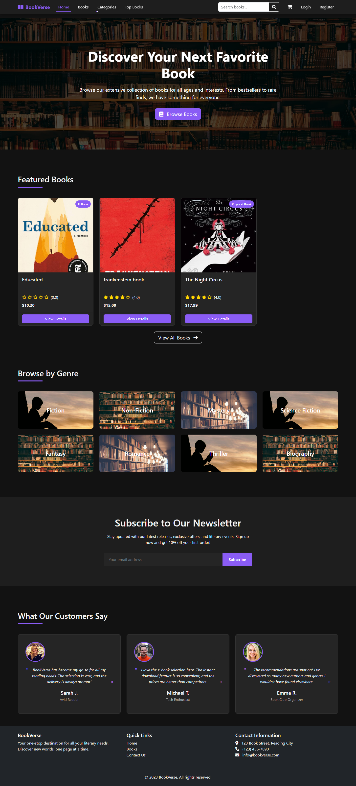

# BookVerse — Online Bookstore Management System

An existing university Java web application, restored and verified on **Apache Tomcat 9.0.102**. It keeps its original **Servlet/JSP architecture**, text-file storage, and dark-purple BookVerse design.



## Project documents

- [Project details, modules, architecture, and limitations](PROJECT_DETAILS.md)
- [All module screenshots](docs/SCREENSHOTS.md) — 45 actual Chrome captures covering 38 JSP files and key dialogs.
- [Download the screenshot ZIP](artifacts/bookverse-screenshots-2026-11-12T10-04-06-522Z.zip)
- [Local authentication setup](LOCAL_AUTH_SETUP.md)
- [Restoration and verification report](PROJECT_RESTORATION_REPORT.md)
- [Remaining manual browser checklist](FRONTEND_MANUAL_TEST_CHECKLIST.md)

## Features

- Customer registration/login, regular and premium profiles.
- Book browsing, search, genres, details, cover uploads, sorting, and filtering.
- Shopping carts and wishlists with notes and priorities.
- Checkout, simulated payment, order history/details, and cancellation.
- Book reviews, ratings, and review editing/deletion.
- Admin dashboard, book inventory, administrator accounts, and order management.

## Technology

Java 8-compatible bytecode built with JDK 17; Maven WAR packaging; `javax.servlet` 4.0; JSP/JSTL; Tomcat 9; Bootstrap and existing frontend libraries. Custom linked lists and sorting algorithms remain part of the implementation. There is no Spring Boot migration or database requirement.

## Run locally on Windows

1. Install **JDK 17** and Maven; add Maven's `bin` directory to your user `Path`.
2. Extract **Tomcat 9.0.102** to `.runtime/apache-tomcat-9.0.102/` in this repository, or pass its directory with `-TomcatHome`.
3. From the repository root:

```powershell
powershell.exe -NoProfile -ExecutionPolicy Bypass -File .\onlinebookstore\scripts\run.ps1
```

If your tool locations differ:

```powershell
powershell.exe -NoProfile -ExecutionPolicy Bypass -File .\onlinebookstore\scripts\run.ps1 -JavaHome 'C:\path\to\jdk-17' -MavenHome 'C:\path\to\maven' -TomcatHome 'C:\path\to\apache-tomcat-9.0.102'
```

Open **http://localhost:8080/onlinebookstore/**. Stop with Ctrl+C. With the default workspace-local Tomcat/JDK locations, `scripts/stop.ps1` is also available.

### Create private local accounts

No working passwords, private account records, or password vaults are published. A fresh checkout seeds clean development files and lets the existing book initializer populate the catalog. After the first build/start, stop the server and use masked password prompts:

```powershell
powershell.exe -NoProfile -ExecutionPolicy Bypass -File .\onlinebookstore\scripts\setup-dev-accounts.ps1
powershell.exe -NoProfile -ExecutionPolicy Bypass -File .\onlinebookstore\scripts\run.ps1 -SkipBuild
```

The first admin provisioned into an empty admin file receives `SUPER_ADMIN`. Passwords for these accounts use salted PBKDF2-HMAC-SHA256. Existing local records are preserved, and duplicate names are rejected. See [authentication instructions](LOCAL_AUTH_SETUP.md).

- Customer login: `/onlinebookstore/login`
- Admin login: `/onlinebookstore/admin/login`

## Data and verification

Runtime records and uploaded covers live outside the WAR in `.runtime/bookstore-data/` and `.runtime/bookstore-covers/`. They are excluded from Git. The repository includes clean `demo-data` files, not the original private dataset.

The restoration included successful Maven builds, HTTP integration checks, browser workflows at desktop/tablet/mobile sizes, and actual screenshots. The [report](PROJECT_RESTORATION_REPORT.md) distinguishes PASS, historical failures, and NOT TESTED cases. Test runners that create accounts require privately supplied `BOOKVERSE_TEST_CUSTOMER_PASSWORD`, `BOOKVERSE_TEST_ADMIN_USERNAME`, and `BOOKVERSE_TEST_ADMIN_PASSWORD` environment variables; no credentials are embedded in their source.

Payments are simulated. Some historical links refer to unimplemented features, and legacy plaintext accounts remain supported for compatibility. This university application is not presented as a production-hardened commerce/payment system.

The original project README and attribution are retained in [onlinebookstore/README.md](onlinebookstore/README.md).
